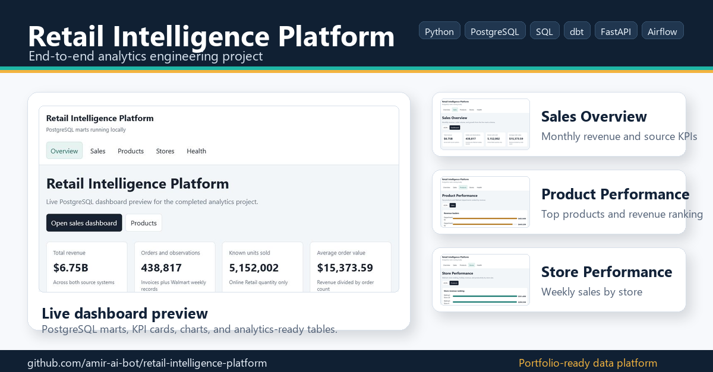
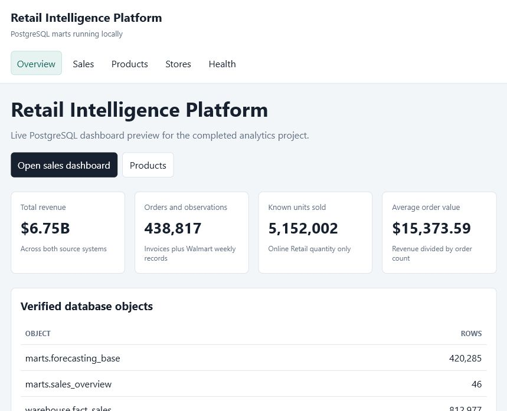
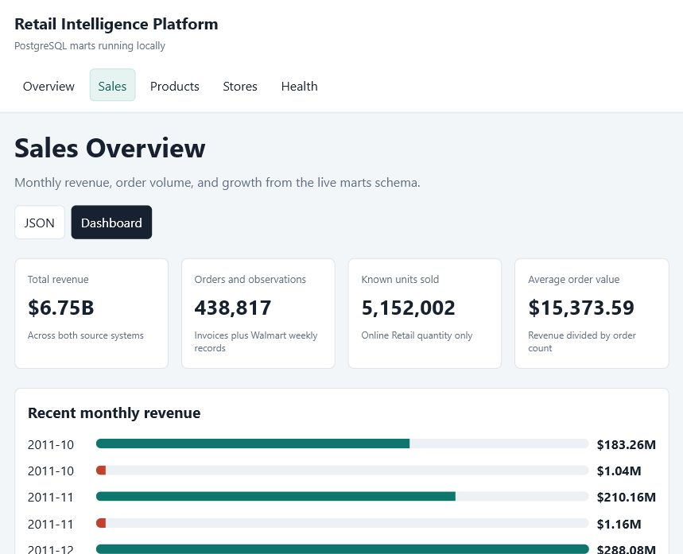
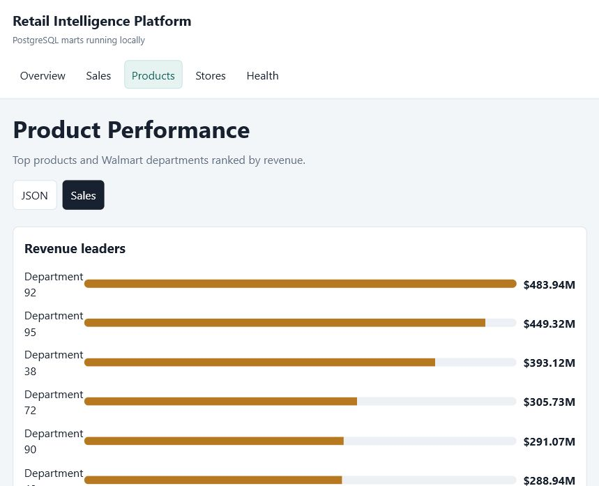
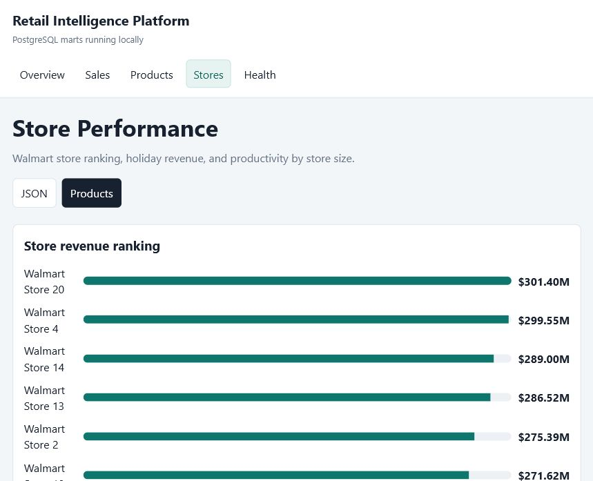

# Retail Intelligence Platform

[](https://github.com/YassinDhibi/retail-intelligence-platform/actions/workflows/ci.yml)

Retail Intelligence Platform is an end-to-end data engineering and analytics
portfolio project for retail sales analysis. It connects Python ETL, PostgreSQL,
SQL modeling, dbt, FastAPI, Airflow, Docker, machine learning, and Power BI
planning into one recruiter-ready system.

## Business Problem

Retail teams need reliable answers to questions such as:

- How are sales trending by month and source system?
- Which products, departments, stores, and customers drive revenue?
- How do holiday weeks and external variables affect Walmart weekly sales?
- What curated data can support BI dashboards, APIs, and forecasting?

This project simulates the analytics platform needed to answer those questions
from raw CSV datasets.

## Solution

The platform cleans local retail datasets, loads them into PostgreSQL, builds
staging and warehouse models, creates dashboard-ready marts, exposes selected
metrics through an API, and prepares a baseline sales forecasting workflow.

## Architecture

```text
Local Kaggle CSV files
        |
        v
Python cleaning pipeline
        |
        v
PostgreSQL raw schema
        |
        v
SQL staging models
        |
        v
Warehouse star schema
        |
        v
Business marts
        |
        +--> Power BI dashboard plan
        +--> FastAPI analytics endpoints
        +--> ML forecasting module
        `--> dbt docs and tests
```

Airflow orchestrates the full local workflow, and Docker provides PostgreSQL
plus the API service.

## Tech Stack

| Area | Tools |
| --- | --- |
| Data processing | Python, pandas |
| Database | PostgreSQL |
| Modeling | SQL, star schema, dbt |
| Orchestration | Airflow |
| API | FastAPI, SQLAlchemy, Pydantic |
| Machine learning | scikit-learn, joblib |
| BI | Power BI specification and DAX |
| DevOps | Docker, Docker Compose, GitHub Actions |

## Repository Structure

```text
retail-intelligence-platform/
|-- airflow/        # Airflow DAG for pipeline orchestration
|-- api/            # FastAPI analytics and prediction service
|-- dashboard/      # Power BI plan, layouts, and DAX measures
|-- data/           # Local-only raw and processed datasets
|-- dbt/            # dbt analytics engineering layer
|-- docs/           # Technical and business documentation
|-- ml/             # Forecasting model scripts and local model folder
|-- notebooks/      # Exploration and modeling notebooks
|-- screenshots/    # Dashboard/API screenshots for portfolio use
|-- sql/            # Raw, staging, warehouse, and marts SQL
|-- src/            # Python extraction, cleaning, and loading scripts
|-- Dockerfile
|-- docker-compose.yml
`-- requirements.txt
```

## Data Pipeline

1. Raw CSV files are stored locally under `data/raw/`.
2. `src/transform.py` cleans Online Retail and Walmart datasets.
3. `src/load_to_postgres.py` loads cleaned CSVs into `raw`.
4. `sql/02_create_staging_tables.sql` builds typed staging tables.
5. `sql/03_create_warehouse_tables.sql` builds the star schema.
6. `sql/04_create_marts.sql` builds analytics-ready marts.

Verified raw load:

| Raw table | Rows |
| --- | ---: |
| `raw.online_retail_clean` | 392,692 |
| `raw.walmart_train_clean` | 420,285 |
| `raw.walmart_test_clean` | 115,064 |
| `raw.walmart_features_clean` | 8,190 |
| `raw.walmart_stores_clean` | 45 |

## Warehouse Design

The warehouse uses a source-aware star schema:

- `warehouse.dim_date`
- `warehouse.dim_product`
- `warehouse.dim_customer`
- `warehouse.dim_store`
- `warehouse.fact_sales`

Verified warehouse fact rows: **812,977**.

The design keeps Online Retail and Walmart analytically compatible without
pretending the datasets are transactionally connected.

## Business Marts

The `marts` schema contains:

- `marts.sales_overview`
- `marts.product_performance`
- `marts.customer_performance`
- `marts.store_performance`
- `marts.forecasting_base`

See `docs/business_marts.md` for KPI definitions and verified row counts.

## dbt Layer

The dbt project lives in `dbt/retail_analytics/`.

It uses a hybrid approach: the verified PostgreSQL SQL scripts remain the source
of truth, while dbt reads those objects as sources and materializes dbt-managed
copies for documentation and tests.

Commands:

```powershell
cd dbt/retail_analytics
dbt run
dbt test
dbt docs generate
dbt docs serve
```

See `docs/dbt.md`.

## Airflow Pipeline

The DAG `retail_intelligence_pipeline` runs:

```text
clean_data
  -> load_raw_tables
  -> refresh_staging
  -> refresh_warehouse
  -> refresh_marts
  -> train_forecasting_model
```

See `docs/airflow_pipeline.md`.

## ML Forecasting

The ML module trains a baseline `LinearRegression` model from
`marts.forecasting_base`.

Commands:

```powershell
python ml/train_forecasting_model.py
python ml/model_evaluation.py
python ml/predict_sales.py --store-id 1 --department-id 1 --store-type A
```

The model artifact is saved locally to:

```text
ml/models/sales_forecasting_model.pkl
```

Model binaries are intentionally ignored by Git.

See `docs/ml_forecasting.md`.

## FastAPI

Run locally:

```powershell
uvicorn api.main:app --reload
```

Main endpoints:

- `GET /`
- `GET /health`
- `GET /sales-overview`
- `GET /sales-overview/monthly`
- `GET /top-products`
- `GET /store-performance`
- `POST /predict-sales`

See `docs/api.md`.

## Docker

Build and run PostgreSQL plus the API:

```powershell
docker compose up --build
```

Docker services:

- `postgres`
- `api`

See `docs/docker_setup.md`.

## Power BI Dashboard Plan

Dashboard pages:

1. Executive Overview
2. Sales Trends
3. Product Performance
4. Customer Analysis
5. Store Performance
6. Forecasting & Recommendations

See:

- `dashboard/powerbi_dashboard_plan.md`
- `dashboard/measures_dax.md`
- `dashboard/page_layouts.md`

## How To Run Locally

Create and activate a virtual environment:

```powershell
python -m venv .venv
.venv\Scripts\activate
pip install -r requirements.txt
```

Create `.env` from `.env.example`:

```text
POSTGRES_HOST=localhost
POSTGRES_PORT=5432
POSTGRES_DB=retail_warehouse
POSTGRES_USER=postgres
POSTGRES_PASSWORD=your_password
```

Run the core pipeline:

```powershell
python src/transform.py
python src/load_to_postgres.py
psql -h localhost -p 5432 -U postgres -d retail_warehouse -f sql/02_create_staging_tables.sql
psql -h localhost -p 5432 -U postgres -d retail_warehouse -f sql/03_create_warehouse_tables.sql
psql -h localhost -p 5432 -U postgres -d retail_warehouse -f sql/04_create_marts.sql
```

Optional:

```powershell
python ml/train_forecasting_model.py
uvicorn api.main:app --reload
```

## Screenshots

The repository includes local dashboard preview screenshots generated from the
live PostgreSQL marts.

### LinkedIn / Portfolio Showcase



### Dashboard Overview



### Sales Overview



### Product Performance



### Store Performance



## Future Improvements

- Add automated SQL data quality checks.
- Add pytest coverage for API service helpers.
- Add model comparison against Random Forest or XGBoost.
- Add dbt exposures for BI dashboards.
- Add CI jobs for SQL linting and dbt parsing.
- Add final Power BI screenshots.

## Author

Yassin Dhibi
